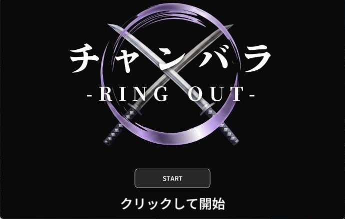

# チャンバラ -RING OUT-

4人チームで制作した対戦ゲームを、スマホの傾きで遊べる対CPUのWeb版に移植。

[作品を見る](https://eisuke29.github.io/portfolio/work2.html) · [ポートフォリオ](https://eisuke29.github.io/portfolio/)



## 原版とWeb版

原版はArduino Uno・MPU-6050を剣型コントローラーに使い、ProcessingのPC間通信で2人対戦する4人チームのゲームです。2026年1月19日の発表会で学生投票1位。

本人の担当は構想のとりまとめ、Arduino入力とProcessingへの通信、デバイス・入力制御です。

このリポジトリはチームに公開を確認済みの**Web移植版**です。スマートフォンの傾きで剣を振り、CPUと対戦します。原版のPC対戦とは操作と構成が異なります。チーム原版のコードは収録していません。

## ローカルで動かす

このリポジトリのフォルダで次を実行し、http://localhost:8000/ を開きます。

```sh
python -m http.server 8000
```

スマートフォンのセンサー操作はHTTPS、または端末で許可された環境が必要です。遊び方はゲーム内の動画で確認できます。スマホ実機のセンサー操作は今回未確認です。


## 制作者・権利

木下瑛介 / Eisuke Kinoshita（[Eisuke29](https://github.com/Eisuke29)）。共同制作・外部素材については上記の説明を参照してください。自作のコード・映像・デザインについて、別途記載のない限り無断での再配布は許諾していません。外部ライブラリ・モデル・フォント等にはそれぞれのライセンスが適用されます。
